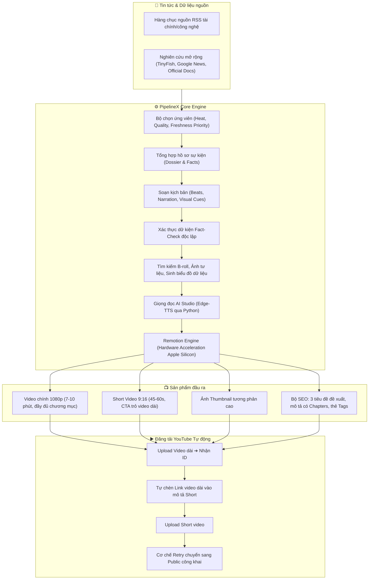

# PipelineX — Zero-Touch Automated AI Video Newsroom & Multi-Channel YouTube Engine

<p align="center">
  
  
  
  
  
  
  
</p>

---

## 📌 Giới thiệu (Overview)

**PipelineX** là hệ thống tự động hóa toàn diện từ thu thập tin tức, nghiên cứu tài liệu, viết kịch bản, kiểm chứng dữ kiện (fact-checking), tổng hợp giọng đọc AI, tạo biểu đồ đồ họa, dựng video (1080p ngang & 9:16 dọc) bằng Remotion, đến tự động xuất bản công khai lên YouTube theo phễu chuyển đổi traffic.

Toàn bộ hệ thống được thiết kế để:
1. **100% Zero-Touch:** Tự động chọn đề tài hot nhất theo thuật toán xếp hạng ưu tiên (`heat`, `quality`, `freshness`), tự sản xuất và tự động đăng tải công khai lên YouTube vào **3 khung giờ mỗi ngày** (07:30, 12:30, 17:30 giờ Việt Nam) mà không cần can thiệp thủ công.
2. **Chi phí API gần như bằng 0 (Zero Cost):** Vận hành trên chuỗi mô hình LLM miễn phí (NVIDIA NIM, OpenRouter Free, OrcaRouter Free), giọng đọc Edge-TTS chất lượng cao và kho ảnh/video bản quyền miễn phí (Pixabay, Wikimedia Commons, Openverse).
3. **Phễu chuyển đổi Short ➔ Video dài tối ưu:** Short video tự động nhận diện URL của video chính ngay sau khi upload, tự chèn link vào dòng đầu tiên của mô tả Short, kèm lời thoại kêu gọi hành động (CTA) và hiệu ứng động trỏ trực tiếp vào nút "Related video" trên ứng dụng YouTube.
4. **Tích hợp Model Context Protocol (MCP):** Cung cấp 27 MCP Tools cho phép các AI Agent (Antigravity, Claude Code, Cursor,...) kết nối vào điều khiển, biên tập kịch bản, đổi ảnh/biểu đồ, hoặc ra lệnh sản xuất video theo yêu cầu riêng.

---

## 🏗️ Kiến trúc hệ thống (Architecture)



---

## 💻 Yêu cầu hệ thống (Prerequisites)

* **Hệ điều hành:** Windows 10/11 (x64), macOS (Apple Silicon tối ưu cho Remotion hardware acceleration) hoặc Linux (Ubuntu 22.04+).
* **Node.js:** `v24.x` (Khuyến nghị `v24.15.0+`).
* **PostgreSQL:** `v16` hoặc `v17` (chạy cổng mặc định 5432).
* **Python:** `3.10+` (cho module Edge-TTS `tts.py`).
* **FFmpeg:** Đã cài đặt trên PATH máy tính.

---

## 🚀 Hướng dẫn cài đặt từng bước (Quickstart Setup)

### Bước 1: Clone Repository
```bash
git clone https://github.com/thanhtungtav4/PipelineX.git
cd PipelineX
```
*(Nếu làm việc trong thư mục monorepo dự án, toàn bộ mã nguồn chính nằm tại `eval/aihot`)*.

### Bước 2: Cài đặt Dependencies cho Node.js
```bash
# Cài đặt toàn bộ workspaces của engine
npm install

# Cài đặt dependencies cho module render Remotion
cd renderer
npm install
cd ..
```

### Bước 3: Thiết lập môi trường Python cho Edge-TTS
Module giọng đọc dùng `edge-tts` miễn phí (không cần phí Azure Speech). Cần **Python 3.10+** và **FFmpeg** (có `ffprobe`) trên PATH.

Chạy một lệnh, dùng được trên Windows, macOS và Linux — tạo `renderer/.venv` và cài đúng gói:
```bash
npm run video:setup
```

Làm tay (nếu không dùng script trên):
```bash
cd renderer
# macOS / Linux
python3 -m venv .venv
.venv/bin/python -m pip install -r requirements.txt

# Windows (PowerShell hoặc cmd)
py -3 -m venv .venv        # hoặc: python -m venv .venv
.venv\Scripts\python -m pip install -r requirements.txt
```
Không cần `activate`: bộ dựng video gọi thẳng Python trong `.venv` (Windows: `.venv\Scripts\python.exe`; macOS/Linux: `.venv/bin/python`). Muốn dùng trình thông dịch khác thì đặt `VIDEO_PYTHON` trong `.env`.

### Bước 4: Thiết lập Cơ sở dữ liệu PostgreSQL
Khởi tạo cơ sở dữ liệu và chạy migrations:
```bash
# Tạo cơ sở dữ liệu
createdb aihot
# (Hoặc createdb pipelinex_markets nếu chạy kênh Finance)

# Chạy migrations cập nhật schema
npm run db:migrate
```

### Bước 5: Cấu hình biến môi trường (`.env`)
Tạo file `.env` từ file mẫu `.env.example`:
```bash
cp .env.example .env
```

Điền các thông tin quan trọng vào file `.env`:

```env
# 1. DATABASE
DATABASE_URL=postgres://your_user@127.0.0.1:5432/aihot

# 2. CỔNG MẠNG
API_PORT=3001
API_BASE_URL=http://127.0.0.1:3001
SITE_URL=http://localhost:3000

# 3. CHUỖI MÔ HÌNH LLM MIỄN PHÍ (Zero-Cost Chain)
# NVIDIA NIM API (Đăng ký miễn phí 1000 credits tại build.nvidia.com)
NVIDIA_API_KEY=nvapi-...
NVIDIA_MODEL=nvidia/nemotron-3.5-super-vl-120b-a12b

# OpenRouter (Các model miễn phí :free)
OPENROUTER_API_KEY=sk-or-v1-...

# OrcaRouter
ORCAROUTER_API_KEY=sk-orca-...

# Cấu hình chuỗi ưu tiên model cho video
VIDEO_PROVIDERS=nvidia-vl,nvidia-minimax,nvidia-nemotron,openrouter-free,orcarouter

# 4. TƯ LIỆU VÀ HÌNH ẢNH MIỄN PHÍ
PIXABAY_API_KEY=your_pixabay_key

# 5. GIỌNG ĐỌC AI (EDGE-TTS HOÀN TOÀN MIỄN PHÍ)
VIDEO_TTS=edge

# 6. TỰ ĐỘNG HÓA 100% ZERO-TOUCH VÀ YOUTUBE
COLLECT_ENABLED=true
VIDEO_AUTO_ENABLED=true
VIDEO_AUTO_PUBLISH=true
VIDEO_DAILY_TARGET=3
VIDEO_RENDER_CONCURRENCY=4

# 7. TOKEN KẾT NỐI AI AGENT MCP
VIDEO_EDITOR_TOKEN=generate_your_random_secret_token_here
```

---

## 🎬 Hướng dẫn vận hành hệ thống

### 1. Khởi chạy 3 Dịch vụ nền (Development / Production)

Mở 3 cửa sổ terminal riêng biệt (hoặc chạy nền qua tmux / pm2):

* **Terminal 1 — Web Frontend (Giao diện Admin & Quản lý):**
  ```bash
  npm run dev:web
  ```
  Truy cập giao diện quản lý video tại: `http://localhost:3000/admin/videos`

* **Terminal 2 — API Server & MCP Server:**
  ```bash
  npm run dev:api
  ```
  Lắng nghe tại `http://127.0.0.1:3001` (chứa endpoint MCP `/api/admin/video/mcp`).

* **Terminal 3 — Background Worker (Quản lý hàng đợi render & lịch Cron):**
  ```bash
  npm run dev:worker
  ```
  Đảm nhận quét tin, tính toán điểm nóng, tự kích hoạt render video và xuất bản vào 3 khung giờ mỗi ngày.

---

### 2. Lịch chạy tự động mỗi ngày (3 khung giờ)
Worker đã tích hợp sẵn lịch cron `video-daily` (`30 8,13,18 * * *` múi giờ Asia/Shanghai):
* **07:30 sáng** (giờ VN): Tự động chọn tin tức đêm hôm trước và sáng sớm để làm video 1.
* **12:30 trưa** (giờ VN): Tự động làm video 2 từ tin tức sáng.
* **17:30 chiều** (giờ VN): Tự động làm video 3 từ tin tức buổi chiều.

Mỗi đợt chạy sẽ tự động tạo video dài, video Short có kèm liên kết, và đẩy thẳng lên YouTube ở chế độ **Public**.

---

### 3. Kết nối kênh YouTube

1. Mở trình duyệt truy cập `http://localhost:3000/admin/videos`.
2. Bấm nút **"Connect YouTube Channel"**.
3. Tiến hành đăng nhập cấp quyền OAuth bằng tài khoản Google quản lý kênh YouTube của bạn.
4. Sau khi hoàn tất, kênh sẽ ở trạng thái **Connected** và sẵn sàng tự động nhận video.

---

## 🤖 Kết nối AI Agent điều khiển qua MCP (Model Context Protocol)

PipelineX tích hợp sẵn MCP Server tại `http://127.0.0.1:3001/api/admin/video/mcp`, cho phép bạn ra lệnh cho AI Agent (như Antigravity, Claude Code, Cursor) tự khám phá tin tức, biên tập kịch bản và làm video theo ý muốn.

### Cấu hình file `mcp.json` (Antigravity / Claude Desktop / Cursor):
```json
{
  "mcpServers": {
    "pipelinex-editor": {
      "url": "http://127.0.0.1:3001/api/admin/video/mcp",
      "headers": {
        "Authorization": "Bearer <VIDEO_EDITOR_TOKEN_TRONG_ENV>"
      }
    }
  }
}
```

### Danh sách các Tool MCP chính:
* `list_candidates`: Xem danh sách các bài viết ứng viên nóng nhất được xếp hạng ưu tiên.
* `search_stories`: Tìm kiếm tin tức theo từ khóa.
* `make_video`: Khởi động quy trình làm video từ một câu chuyện (`storyId`).
* `get_video`: Xem chi tiết kịch bản, các bước, và kết quả kiểm tra fact-check của video.
* `look_at_video`: Trích xuất hình ảnh thumbnail và các khung hình mẫu để AI kiểm tra mắt thường.
* `edit_script`: Sửa lời thoại từng câu trong kịch bản.
* `edit_visual`: Thay đổi b-roll, biểu đồ dữ liệu hoặc ảnh minh họa.
* `remake`: Dựng lại video từ một bước bất kỳ (ví dụ: dựng lại từ bước `voice` sau khi sửa lời thoại).
* `upload_to_youtube`: Tải video và Short lên YouTube.
* `publish_to_youtube`: Công khai video lên YouTube.

---

## 🛠️ Các tập lệnh tiện ích (Utility Scripts)

* **Đẩy một video có sẵn lên YouTube:**
  ```bash
  node --env-file=.env scripts/push-video.ts <video_id>
  ```
* **Tạo một video theo chủ đề tùy chỉnh (như bài viết East Asia Forum):**
  ```bash
  node --env-file=.env scripts/create-vietnam-video.ts
  ```
* **Quản lý đa kênh (Multi-channel Engine):**
  ```bash
  # Liệt kê các kênh
  npm run channel -- list

  # Tạo kênh mới
  npm run channel -- create tech-news --type ai --title "Tech Daily"

  # Khởi chạy một kênh riêng biệt
  npm run channel -- start tech-news
  ```

---

## ❓ Xử lý sự cố thường gặp (Troubleshooting)

1. **Lỗi `YouTube 403: insufficient permissions` khi comment:**
   * *Nguyên nhân:* Google Cloud Client chưa qua kiểm duyệt (Audit) cho API tự động comment.
   * *Giải pháp:* PipelineX đã tự động bỏ qua API comment và nhúng trực tiếp liên kết video chính vào dòng đầu của mô tả Short video (`👉 WATCH FULL VIDEO: https://youtu.be/...`), đảm bảo 100% video Short luôn có liên kết rõ ràng mà không bao giờ gặp lỗi 403.
2. **Video Short bị trễ trạng thái Public sau khi upload:**
   * *Nguyên nhân:* YouTube cần khoảng 10–20 giây xử lý video Short trước khi chấp nhận chuyển sang trạng thái Public.
   * *Giải pháp:* Module `youtube.ts` của PipelineX đã tích hợp cơ chế tự động thử lại (Retry backoff) tối đa 5 lần với quãng nghỉ 5 giây, đảm bảo chuyển trạng thái Public thành công 100%.
3. **Hiệu năng Render trên macOS:**
   * Remotion đã được tối ưu hóa với Apple Silicon Hardware Acceleration. Bạn có thể điều chỉnh số luồng song song qua biến `VIDEO_RENDER_CONCURRENCY=4` hoặc `6` trong file `.env` tùy thuộc vào dung lượng RAM máy tính của bạn.

---

## 📄 Bản quyền (License)

Dự án phát hành theo giấy phép **MIT License**.
Phát triển và mở rộng từ [AIHOT](https://github.com/KKKKhazix/AIHOT).
